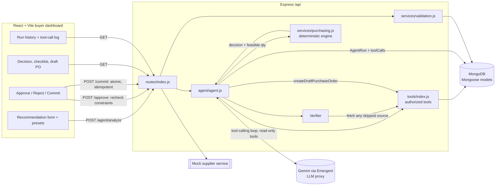
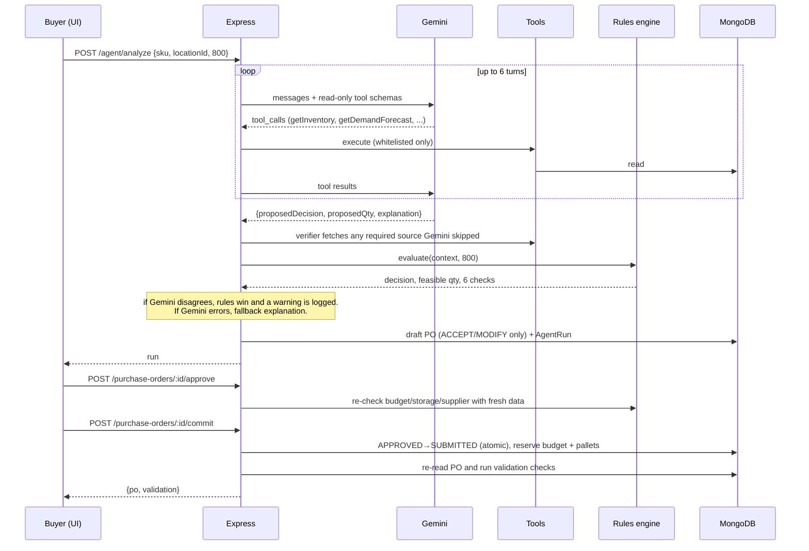

# Architecture

## Analyze sequence

## The six checks

| Check           | Passes when                                                            |
| --------------- | ---------------------------------------------------------------------- |
| inventory       | position < target (a purchase is needed)                               |
| existing-orders | open POs don't already cover the gap                                   |
| demand          | forecast exists and is ≤ 14 days old                                   |
| supplier        | supplier available, qty ≥ MOQ, qty is a multiple of the order multiple |
| budget          | qty × unit price ≤ remaining budget                                    |
| storage         | ⌈qty / units-per-pallet⌉ ≤ free pallets                                |
